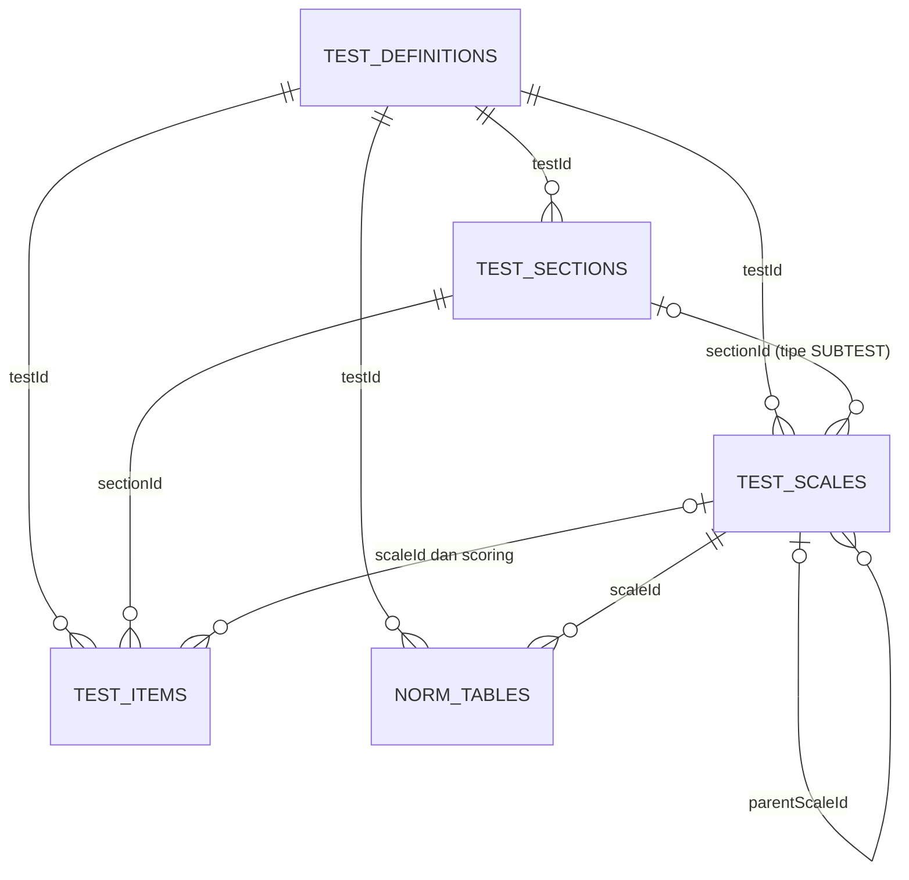

# API dan Service: Input Alat Tes (Versi Sederhana, Admin)

Dokumen ini untuk membangun **frontend admin** yang menginput 25 alat tes. Isinya: tujuan dan relasi tiap collection, function service yang dibutuhkan, dan dokumentasi API (request dan response).

## 0. Ruang lingkup

**Di dalam cakupan** (5 collection):

| Collection         | Isi                               |
| ------------------ | --------------------------------- |
| `test_definitions` | Identitas dan aturan umum tes     |
| `test_sections`    | Subtes (urutan, waktu, instruksi) |
| `test_scales`      | Skala yang diukur                 |
| `test_items`       | Bank soal                         |
| `norm_tables`      | Norma konversi skor               |

Ditambah: endpoint `meta` untuk dropdown frontend, serta `publish` dan `archive` sederhana.

**Diabaikan dulu:**

| Yang diabaikan                                   | Gantinya                                                        |
| ------------------------------------------------ | --------------------------------------------------------------- |
| Upload gambar dan collection `test_assets`       | Gambar diunggah manual ke storage, lalu URL-nya ditulis di soal |
| Bulk create soal dan import/export test pack     | Frontend mengirim soal satu per satu                            |
| `validate` (cek kelayakan terbit)                | Frontend menampilkan `stats` dan `progress` di detail tes       |
| `new-version`                                    | Belum ada, jadi satu tes satu versi                             |
| `interpretation_templates` (narasi laporan)      | Dibutuhkan saat laporan dibuat, bukan saat input tes            |
| Seluruh sisi peserta: assignment, attempt, hasil | -                                                               |

---

## 1. Tujuan dan relasi antar collection



| Collection         | Tujuan                                                                        | Menunjuk ke                                                           | Dipakai nanti oleh                                        |
| ------------------ | ----------------------------------------------------------------------------- | --------------------------------------------------------------------- | --------------------------------------------------------- |
| `test_definitions` | Sampul dan aturan main: nama, kategori, scorer, kebijakan jeda, hak akses     | -                                                                     | Katalog, hak akses subscription, mesin pengerjaan, scorer |
| `test_sections`    | Menjawab **bagaimana tes dikerjakan**: urutan, batas waktu, instruksi, contoh | `test_definitions`                                                    | Mesin pengerjaan (timer, navigasi antar subtes)           |
| `test_scales`      | Menjawab **apa yang diukur** dan muncul di hasil                              | `test_definitions`, `test_sections` (opsional), `test_scales` (induk) | Scorer, laporan, norma                                    |
| `test_items`       | Soal beserta kunci jawaban atau aturan skor                                   | `test_definitions`, `test_sections`, `test_scales`                    | Mesin pengerjaan (tanpa kunci), scorer (dengan kunci)     |
| `norm_tables`      | Mengubah skor mentah menjadi skor standar (WS, SW, IQ, T, dst.)               | `test_definitions`, `test_scales`                                     | Scorer                                                    |

Cara membedakan section dan scale:

| Tes      | Section    | Scale              |
| -------- | ---------- | ------------------ |
| TIU 5    | 1 (`MAIN`) | 1 (`TOTAL`)        |
| Big Five | 1          | 5 (O, C, E, A, N)  |
| DISC     | 1          | 4 (D, I, S, C)     |
| IST      | 9 subtes   | 9 subtes + 1 total |

Section dipakai **mesin pengerjaan**, scale dipakai **mesin scoring**. Soal menunjuk keduanya: soal dikerjakan di sebuah section dan dinilai ke sebuah scale.

---

## 2. Urutan input

| Langkah | Resource        | Mengapa di urutan ini                                                          |
| ------- | --------------- | ------------------------------------------------------------------------------ |
| 1       | Test definition | Semua data lain butuh `testId`                                                 |
| 2       | Section         | Skala bertipe `SUBTEST` butuh `sectionId`                                      |
| 3       | Scale           | Soal dan norma butuh `scaleId`. Skala gabungan butuh skala sumbernya sudah ada |
| 4       | Item            | Butuh `sectionId` dan `scaleId`                                                |
| 5       | Norm            | Butuh `scaleId`. Dibuat setelah rentang skor mentah skala jelas                |
| 6       | Publish         | Setelah semuanya final                                                         |

Menghapus urutannya terbalik: soal dan norma dulu, baru skala, lalu section. Data yang masih dirujuk data lain ditolak dengan `IN_USE`.

**Peringatan publish:** setelah `ACTIVE`, tes terkunci dan tidak bisa diedit (versi sederhana tidak punya `new-version`). Publish baru saat tes sudah final dan akan dipakai peserta.

---

## 3. Struktur service dan arah dependensi

| Service                             | Memakai                    | Catatan                                                                 |
| ----------------------------------- | -------------------------- | ----------------------------------------------------------------------- |
| `TestDefinitionService`             | -                          | Tidak bergantung pada service lain                                      |
| `TestSectionService`                | Definition                 |                                                                         |
| `TestScaleService`                  | Definition, Section        | Memperbarui `scaleIds` milik section                                    |
| `TestItemService`                   | Definition, Section, Scale |                                                                         |
| `NormTableService`                  | Definition, Scale          |                                                                         |
| **`TestCatalogService`** (gabungan) | Semua                      | Detail tes dengan statistik, hapus bertingkat, dan pemeriksaan `IN_USE` |

Aturan: dependensi **satu arah** (Section ← Scale ← Item). Section tidak boleh memakai Scale, karena akan saling bergantung. Pemeriksaan "masih dipakai?" saat hapus (misalnya section masih punya skala) ditaruh di `TestCatalogService`, yang boleh memanggil semua service.

Semua `delete` adalah **soft delete** (mengisi `deletedAt`), dan hanya boleh jika tes masih `DRAFT`.

---

## 4. Konvensi API

**Base URL:** `/api/v1/admin`. **Header:** `Authorization: Bearer <JWT>` (role `SUPERADMIN`) dan `Content-Type: application/json`.

**Id** dikirim dan diterima sebagai string hex 24 karakter. **Waktu** berformat ISO-8601 UTC.

**Respons sukses:**

```jsonc
{ "data": { /* objek */ } }

// daftar dengan paging
{ "data": [ /* objek */ ], "page": { "number": 0, "size": 20, "totalElements": 25, "totalPages": 2 } }
```

**Respons error:**

```jsonc
{
  "error": {
    "code": "VALIDATION_FAILED", // kode tetap untuk logika frontend
    "message": "name wajib diisi", // teks untuk ditampilkan ke admin
  },
}
```

**Update memakai `PUT`:** body menggantikan seluruh isi. Field yang tidak dikirim atau `null` kembali ke default atau kosong, bukan dibiarkan seperti semula. Frontend harus mengirim ulang seluruh data form saat menyimpan.

**Komentar `//` di JSON** hanya penjelasan dan harus dihapus sebelum request dikirim.

**Status HTTP:**

| Status        | Arti                                           |
| ------------- | ---------------------------------------------- |
| `200`         | Berhasil                                       |
| `201`         | Berhasil dibuat                                |
| `204`         | Berhasil dihapus, tanpa body                   |
| `401` / `403` | Belum login / bukan `SUPERADMIN`               |
| `404`         | Data tidak ditemukan (`*_NOT_FOUND`)           |
| `409`         | Konflik: duplikat, tes terkunci, masih dipakai |
| `422`         | Isi request tidak valid                        |

Daftar kode error lengkap ada di bagian 12.

---

## 5. Metadata untuk dropdown

### `GET /meta/test-enums`

Mengembalikan semua nilai enum agar frontend tidak menulis ulang.

**Respons `200`**

```jsonc
{
  "data": {
    "category": [
      "ABILITY",
      "PERSONALITY_FORCED_CHOICE",
      "PERSONALITY_SCALE",
      "INTEREST",
      "SPEED_ENDURANCE",
      "PROJECTIVE",
      "MANAGEMENT",
    ],
    "purpose": ["SELF_DISCOVERY", "RECRUITMENT"],
    "testStatus": ["DRAFT", "ACTIVE", "ARCHIVED"],
    "scoringMode": ["AUTO", "MANUAL", "HYBRID"],
    "resultViewType": [
      "RADAR",
      "BAR",
      "PROFILE",
      "TYPE_CARD",
      "IQ_CARD",
      "NARRATIVE_ONLY",
    ],
    "pausePolicy": ["FREE", "BETWEEN_SECTIONS_ONLY", "NONE"],
    "itemOrderPolicy": ["FIXED", "RANDOMIZED"],
    "educationLevel": [
      "SD",
      "SMP",
      "SMA",
      "SMK",
      "D3",
      "S1",
      "S2",
      "S3",
      "OTHER",
    ],
    "resultAccessLevel": ["STANDARD", "RESTRICTED"],
    "licenseStatus": ["PUBLIC_DOMAIN", "LICENSED", "OWN_WORK", "UNKNOWN"],
    "navigationPolicy": ["FREE", "FORWARD_ONLY"],
    "sectionStatus": ["ACTIVE", "RETIRED"],
    "sectionItemType": [
      "SINGLE_CHOICE",
      "MULTI_CHOICE",
      "TRUE_FALSE",
      "YES_NO",
      "LIKERT",
      "FORCED_CHOICE",
      "MOST_LEAST",
      "RANKING",
      "NUMERIC_INPUT",
      "TEXT_INPUT",
      "DRAWING",
    ],
    "scaleType": [
      "DIMENSION",
      "FACET",
      "SUBTEST",
      "VALIDITY",
      "COMPOSITE",
      "TYPE_POLE",
    ],
    "scaleRole": ["PERFORMANCE", "EXPECTATION", "IMPORTANCE", "REFLECTION"],
    "scoreType": [
      "RAW_ONLY",
      "RAW_AVERAGE",
      "RAW_TO_SW",
      "RAW_TO_WS",
      "RAW_TO_IQ",
      "RAW_TO_T",
      "RAW_TO_STEN",
      "RAW_TO_PERCENTILE",
      "IPSATIVE",
      "RANK_SUM",
    ],
    "compositeMethod": ["SUM", "MEAN"],
    "itemType": [
      "SINGLE_CHOICE",
      "MULTI_CHOICE",
      "TRUE_FALSE",
      "YES_NO",
      "LIKERT",
      "FORCED_CHOICE",
      "MOST_LEAST",
      "RANKING",
      "NUMERIC_INPUT",
      "TEXT_INPUT",
      "DRAWING",
    ],
    "itemStatus": ["ACTIVE", "RETIRED"],
    "normTargetScoreType": [
      "SW",
      "WS",
      "IQ",
      "T_SCORE",
      "STEN",
      "STANINE",
      "PERCENTILE",
    ],
    "normMethod": ["LOOKUP", "MEAN_SD"],
    "normStatus": ["DRAFT", "ACTIVE", "ARCHIVED"],
    "gender": ["ANY", "MALE", "FEMALE"],
  },
}
```

`MATRIX_TASK` (Kraepelin) sengaja tidak ada di `itemType`, karena Kraepelin tidak memakai bank soal. Kraepelin cukup definisi, satu section, dan `config`.

---

## 6. Test Definition

### 6.1 Tujuan dan relasi

Satu dokumen per alat tes. Menyimpan identitas dan **aturan main** yang nanti dibaca banyak pihak: `scorerKey` dipakai scorer, `pausePolicy` dipakai mesin pengerjaan, `requiredFeature` dicocokkan dengan hak akses subscription, dan `resultAccessLevel` menentukan apakah hasil wajib direview psikolog. Menjadi induk bagi section, skala, soal, dan norma lewat `testId`.

### 6.2 Function service (`TestDefinitionService`)

| Function             | Parameter                                                                                                                                                                                                                                                                                                                                                    | Hasil                    | Tujuan                                                                                          | Status                            |
| -------------------- | ------------------------------------------------------------------------------------------------------------------------------------------------------------------------------------------------------------------------------------------------------------------------------------------------------------------------------------------------------------ | ------------------------ | ----------------------------------------------------------------------------------------------- | --------------------------------- |
| `create`             | `code, name, shortName, category, description, instructions, purposes, version, scoringMode, scorerKey, scoringConfig, resultViewType, totalItems, totalDurationSeconds, estimatedMinutes, pausePolicy, disconnectGraceSeconds, itemOrderPolicy, targetAge, minEducation, language, requiredFeature, resultAccessLevel, config, license, thumbnailUrl, tags` | `TestDefinition`         | Membuat tes baru                                                                                | **Perlu perbaikan** (lihat bawah) |
| `update`             | `testId` + semua parameter `create` kecuali `code`                                                                                                                                                                                                                                                                                                           | `TestDefinition`         | Mengganti isi tes (hanya `DRAFT`)                                                               | **Perlu perbaikan**               |
| `getById`            | `testId`                                                                                                                                                                                                                                                                                                                                                     | `TestDefinition`         | Mengambil satu tes, error jika tidak ada                                                        | Baru                              |
| `list`               | `q, category, status, page, size`                                                                                                                                                                                                                                                                                                                            | Halaman `TestDefinition` | Daftar katalog admin                                                                            | Baru                              |
| `delete`             | `testId`                                                                                                                                                                                                                                                                                                                                                     | -                        | Soft delete tes `DRAFT`                                                                         | Baru                              |
| `publish`            | `testId`                                                                                                                                                                                                                                                                                                                                                     | `TestDefinition`         | `DRAFT` menjadi `ACTIVE`                                                                        | Baru                              |
| `archive`            | `testId`                                                                                                                                                                                                                                                                                                                                                     | `TestDefinition`         | `ACTIVE` menjadi `ARCHIVED`                                                                     | Baru                              |
| `requireDraft`       | `testId`                                                                                                                                                                                                                                                                                                                                                     | `TestDefinition`         | Menjamin tes ada dan `DRAFT`. Dipakai service anak                                              | Sudah ada                         |
| `requireNotArchived` | `testId`                                                                                                                                                                                                                                                                                                                                                     | `TestDefinition`         | Menjamin tes ada dan bukan `ARCHIVED`. Dipakai norma, yang masih boleh ditambah setelah publish | Baru                              |

**Perbaikan pada `create` dan `update` yang sudah ada:**

1. `create` selalu menetapkan `status = DRAFT`. Jangan ambil dari request.
2. `update` tidak boleh mengubah `status` dan `code`. Status hanya berubah lewat `publish` dan `archive`.
3. `update` hanya untuk tes `DRAFT` (pakai `requireDraft`).
4. Salin semua field. Yang saat ini terlewat: `scoringConfig`, `targetAge`, `minEducation`, `totalDurationSeconds`, `config`, `license`, `thumbnailUrl`, `tags`.
5. Cek duplikat berdasarkan `(code, version)`, bukan `code` saja.
6. `findById` pada `update` harus memfilter `deletedAt` dan melempar `TEST_NOT_FOUND` jika kosong.
7. Gunakan satu variabel `Instant now`.
8. Isi default: `version = "1.0.0"`, `scoringMode = AUTO`, `resultViewType = PROFILE`, `totalItems = 0`, `pausePolicy = FREE`, `disconnectGraceSeconds = 120`, `itemOrderPolicy = FIXED`, `language = "id"`, `resultAccessLevel = STANDARD`.

### 6.3 Endpoint

| Method   | Path                      | Fungsi                       | Service                         |
| -------- | ------------------------- | ---------------------------- | ------------------------------- |
| `POST`   | `/tests`                  | Membuat tes                  | `create`                        |
| `GET`    | `/tests`                  | Daftar tes                   | `list`                          |
| `GET`    | `/tests/{testId}`         | Detail tes dengan statistik  | `TestCatalogService.getDetail`  |
| `PUT`    | `/tests/{testId}`         | Mengubah tes                 | `update`                        |
| `DELETE` | `/tests/{testId}`         | Menghapus tes beserta isinya | `TestCatalogService.deleteTest` |
| `POST`   | `/tests/{testId}/publish` | Menerbitkan                  | `publish`                       |
| `POST`   | `/tests/{testId}/archive` | Mengarsipkan                 | `archive`                       |

### 6.4 `POST /tests`

```jsonc
{
  // WAJIB. String. Format huruf BESAR, angka, underscore, 2-40 karakter.
  // Bersama "version" harus unik. Tidak bisa diubah setelah dibuat.
  // Tujuan: kunci tetap untuk kode aplikasi dan URL. Contoh: "TIU_5", "BIG_FIVE", "PF16"
  "code": "TIU_5",

  // WAJIB. String 3-120 karakter. Tujuan: nama lengkap di katalog.
  "name": "Tes Inteligensi Umum 5",

  // WAJIB. String maks 40 karakter. Tujuan: nama singkat untuk kartu di UI.
  "shortName": "TIU 5",

  // WAJIB. Enum category. Tujuan: pengelompokan dan menentukan aturan input soal
  // (tes ABILITY wajib punya kunci jawaban, selain itu wajib punya aturan skor).
  "category": "ABILITY",

  // OPSIONAL. String. Default "". Tujuan: deskripsi di halaman katalog.
  "description": "Mengukur kemampuan penalaran lewat analogi gambar",

  // OPSIONAL. String. Default "". Tujuan: instruksi umum sebelum tes dimulai.
  "instructions": "Perhatikan perubahan dari gambar A ke B, lalu terapkan pada gambar C.",

  // OPSIONAL. Array enum purpose. Default ["SELF_DISCOVERY"].
  // Tujuan: filter dan rekomendasi (mandiri atau rekrutmen).
  "purposes": ["SELF_DISCOVERY", "RECRUITMENT"],

  // OPSIONAL. String semver. Default "1.0.0".
  // Tujuan: versi tes, nanti dicatat di setiap hasil agar hasil lama tetap valid.
  "version": "1.0.0",

  // OPSIONAL. Enum. Default "AUTO".
  // AUTO = dinilai sistem, MANUAL = dinilai psikolog (Wartegg), HYBRID = gabungan.
  "scoringMode": "AUTO",

  // WAJIB kecuali scoringMode = "MANUAL". String.
  // Tujuan: nama scorer di kode yang akan menghitung skor tes ini.
  // Belum ada registry scorer, jadi untuk sementara teks bebas. Contoh: "RAW_SUM_ANSWER_KEY"
  "scorerKey": "RAW_SUM_ANSWER_KEY",

  // OPSIONAL. Object bebas. Default {}.
  // Tujuan: parameter scorer, misalnya aturan koreksi MMPI.
  "scoringConfig": {},

  // OPSIONAL. Enum. Default "PROFILE". Tujuan: bentuk tampilan hasil di UI.
  "resultViewType": "PROFILE",

  // OPSIONAL. Integer >= 0. Default 0.
  // Tujuan: jumlah soal yang diharapkan. Frontend membandingkannya dengan stats.items.
  "totalItems": 30,

  // OPSIONAL. Integer detik > 0, atau null. Default null.
  // Tujuan: batas waktu total. Null jika waktu diatur per section atau tanpa batas.
  "totalDurationSeconds": null,

  // OPSIONAL. Integer menit. Default 0. Tujuan: estimasi yang ditampilkan ke peserta.
  "estimatedMinutes": 20,

  // OPSIONAL. Enum. Default "FREE".
  // FREE = bebas jeda, BETWEEN_SECTIONS_ONLY = jeda hanya antar subtes, NONE = tanpa jeda (Kraepelin).
  "pausePolicy": "BETWEEN_SECTIONS_ONLY",

  // OPSIONAL. Integer detik 0-3600. Default 120.
  // Tujuan: toleransi koneksi putus sebelum timer dianggap berjalan.
  "disconnectGraceSeconds": 120,

  // OPSIONAL. Enum. Default "FIXED". FIXED = urutan soal tetap, RANDOMIZED = diacak.
  "itemOrderPolicy": "FIXED",

  // OPSIONAL. Object {min, max} atau null. min tidak boleh lebih besar dari max.
  // Tujuan: rentang usia yang sesuai dengan norma.
  "targetAge": { "min": 17, "max": 65 },

  // OPSIONAL. Enum educationLevel atau null. Default null.
  // Tujuan: syarat pendidikan minimum.
  "minEducation": null,

  // OPSIONAL. String. Default "id". Tujuan: bahasa soal.
  "language": "id",

  // WAJIB. String format "test.<nama_huruf_kecil>".
  // Tujuan: kunci hak akses. Dicocokkan dengan fitur di subscription nanti.
  "requiredFeature": "test.tiu_5",

  // OPSIONAL. Enum. Default "STANDARD".
  // RESTRICTED = hasil tertahan sampai psikolog menyetujui (MMPI, Wartegg).
  "resultAccessLevel": "STANDARD",

  // OPSIONAL. Object bebas. Default {}.
  // Tujuan: konfigurasi unik per tes tanpa mengubah skema.
  // Contoh Kraepelin: { "columnCount": 40, "digitsPerColumn": 50, "secondsPerColumn": 30 }
  "config": {},

  // OPSIONAL. Object {owner, status, validUntil}. Default {status:"UNKNOWN"}.
  // status: PUBLIC_DOMAIN | LICENSED | OWN_WORK | UNKNOWN. validUntil berformat "2027-12-31".
  // Tujuan: mencatat hak penggunaan tes (banyak tes berhak cipta penerbit).
  "license": {
    "owner": "LPSP3 Fakultas Psikologi UI",
    "status": "UNKNOWN",
    "validUntil": null,
  },

  // OPSIONAL. String URL atau null. Tujuan: gambar kartu tes.
  "thumbnailUrl": null,

  // OPSIONAL. Array string. Default []. Tujuan: pencarian dan filter.
  "tags": ["inteligensi", "penalaran"],

  // TIDAK PERLU DIKIRIM: status (selalu DRAFT), id, createdAt, updatedAt.
}
```

**Respons `201`**

```jsonc
{
  "data": {
    "id": "66f1a1c2e4b0a1b2c3d4e5f6",
    "code": "TIU_5",
    "name": "Tes Inteligensi Umum 5",
    "shortName": "TIU 5",
    "category": "ABILITY",
    "description": "Mengukur kemampuan penalaran lewat analogi gambar",
    "instructions": "Perhatikan perubahan dari gambar A ke B, lalu terapkan pada gambar C.",
    "purposes": ["SELF_DISCOVERY", "RECRUITMENT"],
    "version": "1.0.0",
    "status": "DRAFT",
    "scoringMode": "AUTO",
    "scorerKey": "RAW_SUM_ANSWER_KEY",
    "scoringConfig": {},
    "resultViewType": "PROFILE",
    "totalItems": 30,
    "totalDurationSeconds": null,
    "estimatedMinutes": 20,
    "pausePolicy": "BETWEEN_SECTIONS_ONLY",
    "disconnectGraceSeconds": 120,
    "itemOrderPolicy": "FIXED",
    "targetAge": { "min": 17, "max": 65 },
    "minEducation": null,
    "language": "id",
    "requiredFeature": "test.tiu_5",
    "resultAccessLevel": "STANDARD",
    "config": {},
    "license": {
      "owner": "LPSP3 Fakultas Psikologi UI",
      "status": "UNKNOWN",
      "validUntil": null,
    },
    "thumbnailUrl": null,
    "tags": ["inteligensi", "penalaran"],
    "createdAt": "2026-10-04T08:00:00Z",
    "updatedAt": "2026-10-04T08:00:00Z",
  },
}
```

Bentuknya sama dengan `TestDefinitionResponse` yang sudah Anda punya.

### 6.5 `GET /tests`

| Query          | Keterangan                                |
| -------------- | ----------------------------------------- |
| `q`            | Cari di `code`, `name`, `shortName`       |
| `category`     | Filter kategori                           |
| `status`       | `DRAFT`, `ACTIVE`, `ARCHIVED`             |
| `page`, `size` | Default `0` dan `20`, maksimum `size` 100 |

**Respons `200`** (field ringkas untuk tabel)

```jsonc
{
  "data": [
    {
      "id": "66f1a1c2e4b0a1b2c3d4e5f6",
      "code": "TIU_5",
      "name": "Tes Inteligensi Umum 5",
      "shortName": "TIU 5",
      "category": "ABILITY",
      "version": "1.0.0",
      "status": "DRAFT",
      "scoringMode": "AUTO",
      "totalItems": 30,
      "updatedAt": "2026-10-04T09:30:00Z",
    },
  ],
  "page": { "number": 0, "size": 20, "totalElements": 1, "totalPages": 1 },
}
```

### 6.6 `GET /tests/{testId}`

Isinya sama dengan respons `POST`, ditambah `stats` dan `progress` untuk menunjukkan kemajuan input.

```jsonc
{
  "data": {
    "id": "66f1a1c2e4b0a1b2c3d4e5f6",
    "code": "TIU_5",
    "status": "DRAFT",
    "totalItems": 30,

    // (field lain sama seperti respons POST, dipersingkat di sini)

    // Jumlah data aktif di tiap collection anak.
    // Tujuan: admin melihat kelengkapan tanpa membuka tiap halaman.
    "stats": { "sections": 1, "scales": 1, "items": 28, "norms": 1 },

    // Perbandingan jumlah soal yang diharapkan (section.itemCount) dengan yang sudah diinput.
    // Tujuan: menunjukkan subtes mana yang belum lengkap (28 dari 30).
    "progress": [
      {
        "sectionId": "66f2b1c2e4b0a1b2c3d4e5f7",
        "code": "MAIN",
        "expectedItems": 30,
        "enteredItems": 28,
      },
    ],
  },
}
```

### 6.7 `PUT /tests/{testId}`

Body sama dengan `POST /tests` **tanpa** `code`. Hanya untuk tes `DRAFT`. Respons `200` berisi tes terbaru (bentuk sama dengan respons `POST`).

| Error                  | Penyebab                                              |
| ---------------------- | ----------------------------------------------------- |
| `TEST_NOT_FOUND` (404) | `testId` tidak ada atau sudah dihapus                 |
| `TEST_IMMUTABLE` (409) | Tes bukan `DRAFT`                                     |
| `DUPLICATE_CODE` (409) | Kombinasi `code` dan `version` sudah dipakai tes lain |

### 6.8 `DELETE /tests/{testId}`

Soft delete tes **dan semua isinya** (section, skala, soal, norma). Respons `204`. Hanya untuk tes `DRAFT`, selain itu `TEST_NOT_FOUND` atau `TEST_IMMUTABLE`.

### 6.9 `POST /tests/{testId}/publish` dan `/archive`

Tanpa body. Respons `200` berisi tes dengan status baru.

| Endpoint  | Dari ke                | Error                                     |
| --------- | ---------------------- | ----------------------------------------- |
| `publish` | `DRAFT` ke `ACTIVE`    | `INVALID_STATE` (409) jika bukan `DRAFT`  |
| `archive` | `ACTIVE` ke `ARCHIVED` | `INVALID_STATE` (409) jika bukan `ACTIVE` |

Versi sederhana **tidak memeriksa kelengkapan** saat publish. Cek `stats` dan `progress` secara manual sebelum menerbitkan.

---

## 7. Section (subtes)

### 7.1 Tujuan dan relasi

Menjawab **bagaimana tes dikerjakan**. Tes tanpa subtes tetap punya satu section (kode `MAIN`). Dibaca mesin pengerjaan untuk timer, instruksi, contoh, dan aturan boleh kembali atau tidak.

| Relasi                            | Keterangan                                                             |
| --------------------------------- | ---------------------------------------------------------------------- |
| `testId` → `test_definitions`     | Section milik satu tes. Diambil dari path, bukan dari body             |
| `test_items.sectionId` → section  | Soal dikerjakan di section ini                                         |
| `test_scales.sectionId` → section | Skala bertipe `SUBTEST` sama dengan satu section                       |
| `scaleIds` (di section)           | **Turunan** otomatis dari skala yang menunjuk section ini. Bukan input |

### 7.2 Function service (`TestSectionService`)

| Function                                | Parameter                                                                                                                                                             | Hasil                       | Tujuan                                  | Status    |
| --------------------------------------- | --------------------------------------------------------------------------------------------------------------------------------------------------------------------- | --------------------------- | --------------------------------------- | --------- |
| `create`                                | `testId, code, order, name, instructions, examples, showExamplesFirst, timeLimitSeconds, itemCount, navigationPolicy, defaultItemType, stimulusPhase, config, status` | `TestSection`               | Membuat section                         | Sudah ada |
| `update`                                | `testId, sectionId` + parameter `create` kecuali `code`                                                                                                               | `TestSection`               | Mengganti isi section                   | Sudah ada |
| `findInTest`, `getInTest`, `findByCode` | `testId` + `sectionId` atau `code`                                                                                                                                    | `TestSection`               | Pencarian untuk service lain            | Sudah ada |
| `attachScale`, `detachScale`            | `sectionId, scaleId`                                                                                                                                                  | -                           | Menjaga `scaleIds` tetap sinkron        | Sudah ada |
| `listByTest`                            | `testId`                                                                                                                                                              | Daftar section urut `order` | Daftar untuk frontend                   | Baru      |
| `delete`                                | `testId, sectionId`                                                                                                                                                   | -                           | Soft delete section (hanya tes `DRAFT`) | Baru      |
| `countByTest`                           | `testId`                                                                                                                                                              | Jumlah                      | Statistik                               | Baru      |
| `softDeleteAllByTest`                   | `testId`                                                                                                                                                              | -                           | Hapus bertingkat saat tes dihapus       | Baru      |

Pemeriksaan "masih ada soal atau skala di section ini" **tidak** dilakukan di service ini, melainkan di `TestCatalogService.deleteSection`.

### 7.3 Endpoint

| Method   | Path                                   | Fungsi                        |
| -------- | -------------------------------------- | ----------------------------- |
| `POST`   | `/tests/{testId}/sections`             | Membuat section               |
| `GET`    | `/tests/{testId}/sections`             | Daftar section (tanpa paging) |
| `GET`    | `/tests/{testId}/sections/{sectionId}` | Detail section                |
| `PUT`    | `/tests/{testId}/sections/{sectionId}` | Mengubah section              |
| `DELETE` | `/tests/{testId}/sections/{sectionId}` | Menghapus section             |

### 7.4 `POST /tests/{testId}/sections`

```jsonc
{
  // WAJIB. String huruf BESAR/angka/underscore, 1-20 karakter. Unik per tes. Tidak bisa diubah.
  // Tujuan: kunci subtes. Contoh: "MAIN", "SE", "WA".
  "code": "MAIN",

  // WAJIB. Integer >= 1, unik per tes. Tujuan: urutan pengerjaan.
  "order": 1,

  // WAJIB. String. Tujuan: nama subtes yang dilihat peserta.
  "name": "Analogi Gambar",

  // OPSIONAL. String. Default "". Tujuan: instruksi khusus subtes.
  "instructions": "Perhatikan perubahan dari gambar A ke B, terapkan pada gambar C.",

  // OPSIONAL. Array object. Default [].
  // Tujuan: soal contoh/latihan sebelum waktu berjalan (IST, CFIT, TIU 5).
  // Isi objek bebas (belum divalidasi). Bentuk yang disarankan:
  "examples": [
    {
      "content": {
        "text": "Contoh 1",
        "images": [
          { "label": "A", "url": "https://cdn.example.com/ex1-a.png" },
        ],
      },
      "options": [{ "key": "1" }, { "key": "2" }, { "key": "3" }],
      "answer": ["3"],
      "explanation": "Gambar mengecil, jadi jawabannya pilihan 3.",
    },
  ],

  // OPSIONAL. Boolean. Default true. Tujuan: tampilkan contoh dulu sebelum soal pertama.
  "showExamplesFirst": true,

  // OPSIONAL. Integer detik > 0, atau null. Default null.
  // Tujuan: batas waktu subtes (server menutup otomatis saat habis). Isi dari manual tes.
  "timeLimitSeconds": null,

  // OPSIONAL. Integer >= 0. Default 0.
  // Tujuan: jumlah soal yang diharapkan. Dipakai kolom "progress" di detail tes.
  "itemCount": 30,

  // OPSIONAL. Enum. Default "FREE". FORWARD_ONLY = tidak boleh kembali ke soal sebelumnya.
  "navigationPolicy": "FREE",

  // OPSIONAL. Enum. Default "SINGLE_CHOICE".
  // Tujuan: komponen UI bawaan untuk soal di section ini.
  "defaultItemType": "SINGLE_CHOICE",

  // OPSIONAL. Object atau null. Default null.
  // Tujuan: fase hafalan sebelum soal (IST subtes ME). Jika diisi, wajib ada
  // contentType (String) dan displaySeconds (angka > 0). Contoh:
  // { "contentType": "WORD_LIST", "displaySeconds": 180, "hideAfter": true, "content": { "words": ["a", "b"] } }
  "stimulusPhase": null,

  // OPSIONAL. Object bebas. Default {}. Tujuan: konfigurasi unik section.
  "config": {},

  // OPSIONAL. Enum "ACTIVE" | "RETIRED". Default "ACTIVE". RETIRED = disembunyikan tanpa dihapus.
  "status": "ACTIVE",

  // TIDAK PERLU DIKIRIM: testId (dari path), testVersion (dari tes), scaleIds (otomatis).
}
```

**Respons `201`** (sama dengan `TestSectionResponse`)

```jsonc
{
  "data": {
    "id": "66f2b1c2e4b0a1b2c3d4e5f7",
    "testId": "66f1a1c2e4b0a1b2c3d4e5f6",
    "testVersion": "1.0.0",
    "code": "MAIN",
    "order": 1,
    "name": "Analogi Gambar",
    "instructions": "Perhatikan perubahan dari gambar A ke B, terapkan pada gambar C.",
    "examples": [],
    "showExamplesFirst": true,
    "timeLimitSeconds": null,
    "itemCount": 30,
    "navigationPolicy": "FREE",
    "defaultItemType": "SINGLE_CHOICE",
    "scaleIds": [], // terisi otomatis setelah skala dibuat dengan sectionId ini
    "stimulusPhase": null,
    "config": {},
    "status": "ACTIVE",
    "createdAt": "2026-10-04T09:00:00Z",
    "updatedAt": "2026-10-04T09:00:00Z",
  },
}
```

**`GET /tests/{testId}/sections`** mengembalikan `{ "data": [ /* objek di atas, urut order */ ] }`.

### 7.5 `PUT /tests/{testId}/sections/{sectionId}`

Body sama dengan `POST` **tanpa** `code`. Kirim ulang semua field. Respons `200` berisi section terbaru.

### 7.6 `DELETE /tests/{testId}/sections/{sectionId}`

Respons `204`. Ditolak dengan `IN_USE` jika masih ada skala atau soal yang menunjuk section ini.

| Error                     | Penyebab                               |
| ------------------------- | -------------------------------------- |
| `DUPLICATE_CODE` (409)    | `code` sudah ada di tes ini            |
| `ORDER_CONFLICT` (409)    | `order` sudah dipakai section lain     |
| `SECTION_NOT_FOUND` (404) | `sectionId` tidak ada di tes ini       |
| `TEST_IMMUTABLE` (409)    | Tes bukan `DRAFT`                      |
| `IN_USE` (409)            | (DELETE) masih dirujuk skala atau soal |

Untuk menukar urutan dua section, ubah salah satunya ke nomor sementara (misalnya 99), lalu ubah yang lain, lalu kembalikan. Endpoint reorder sengaja ditunda.

---

## 8. Scale (skala)

### 8.1 Tujuan dan relasi

Menjawab **apa yang diukur** dan akan muncul di hasil. Menjadi "kunci" yang menyambungkan soal, norma, dan nanti hasil serta narasi.

| Relasi                                                             | Keterangan                            |
| ------------------------------------------------------------------ | ------------------------------------- |
| `testId` → `test_definitions`                                      | Skala milik satu tes                  |
| `sectionId` → `test_sections`                                      | Opsional. Wajib jika tipe `SUBTEST`   |
| `parentScaleId` → skala lain                                       | Hierarki (facet di bawah dimensi)     |
| `composite.sourceScaleCodes` → skala lain                          | Skor gabungan, merujuk lewat **kode** |
| `test_items.scaleId` dan `scoring.scaleMappings[].scaleId` → skala | Soal dinilai ke skala ini             |
| `norm_tables.scaleId` → skala                                      | Norma konversi skala ini              |

### 8.2 Function service (`TestScaleService`)

| Function                                | Parameter                                                                                                                                                                     | Hasil                     | Tujuan                                                             | Status    |
| --------------------------------------- | ----------------------------------------------------------------------------------------------------------------------------------------------------------------------------- | ------------------------- | ------------------------------------------------------------------ | --------- |
| `create`                                | `testId, code, name, type, role, parentScaleId, sectionId, order, description, lowLabel, highLabel, rawMin, rawMax, scoreType, composite, isReported, isValidityScale, color` | `TestScale`               | Membuat skala                                                      | Sudah ada |
| `update`                                | `testId, scaleId` + parameter `create` kecuali `code`                                                                                                                         | `TestScale`               | Mengganti isi skala                                                | Sudah ada |
| `findInTest`, `getInTest`, `findByCode` | `testId` + `scaleId` atau `code`                                                                                                                                              | `TestScale`               | Pencarian untuk service lain                                       | Sudah ada |
| `listByTest`                            | `testId, sectionId?`                                                                                                                                                          | Daftar skala urut `order` | Daftar untuk frontend                                              | Baru      |
| `delete`                                | `testId, scaleId`                                                                                                                                                             | -                         | Soft delete skala, sekaligus melepasnya dari `scaleIds` section    | Baru      |
| `countByTest`                           | `testId`                                                                                                                                                                      | Jumlah                    | Statistik                                                          | Baru      |
| `countBySection`                        | `testId, sectionId`                                                                                                                                                           | Jumlah                    | Pemeriksaan hapus section                                          | Baru      |
| `countByParent`                         | `testId, scaleId`                                                                                                                                                             | Jumlah                    | Pemeriksaan hapus: skala induk                                     | Baru      |
| `findCompositeUsing`                    | `testId, code`                                                                                                                                                                | Daftar kode               | Pemeriksaan hapus: skala yang dipakai sebagai sumber skor gabungan | Baru      |
| `softDeleteAllByTest`                   | `testId`                                                                                                                                                                      | -                         | Hapus bertingkat saat tes dihapus                                  | Baru      |

### 8.3 Endpoint

| Method   | Path                               | Fungsi                                |
| -------- | ---------------------------------- | ------------------------------------- |
| `POST`   | `/tests/{testId}/scales`           | Membuat skala                         |
| `GET`    | `/tests/{testId}/scales`           | Daftar skala (`?sectionId=` opsional) |
| `GET`    | `/tests/{testId}/scales/{scaleId}` | Detail skala                          |
| `PUT`    | `/tests/{testId}/scales/{scaleId}` | Mengubah skala                        |
| `DELETE` | `/tests/{testId}/scales/{scaleId}` | Menghapus skala                       |

### 8.4 `POST /tests/{testId}/scales`

```jsonc
{
  // WAJIB. String huruf/angka/underscore, 1-30 karakter. Unik per tes. Tidak bisa diubah.
  // Tujuan: kunci skala. Contoh: "TOTAL", "E", "SE", "Hs" (MMPI), "ACT01_P" (MSAI).
  "code": "TOTAL",

  // WAJIB. String. Tujuan: nama skala di laporan.
  "name": "Skor Total TIU 5",

  // OPSIONAL. Enum. Default "DIMENSION".
  // SUBTEST = sama dengan satu section (wajib sectionId). FACET = turunan dimensi.
  // VALIDITY = skala validitas (MMPI: L, F, K). COMPOSITE = gabungan skala lain (wajib composite).
  "type": "SUBTEST",

  // OPSIONAL. Enum. Default "PERFORMANCE".
  // Khusus MSAI: aktivitas yang sama diukur 3 kali (PERFORMANCE, EXPECTATION, IMPORTANCE).
  "role": "PERFORMANCE",

  // OPSIONAL. Id skala induk atau null. Harus skala di tes yang sama, tanpa siklus.
  // Tujuan: hierarki (Big Five: facet di bawah dimensi).
  "parentScaleId": null,

  // WAJIB jika type "SUBTEST", selain itu opsional. Id section di tes yang sama.
  // Tujuan: menghubungkan skala dengan subtes yang dinilainya.
  "sectionId": "66f2b1c2e4b0a1b2c3d4e5f7",

  // OPSIONAL. Integer. Default otomatis (urutan terakhir + 1). Tidak harus unik.
  // Tujuan: urutan di laporan dan grafik.
  "order": 1,

  // OPSIONAL. String. Default "". Tujuan: penjelasan skala di laporan.
  "description": "Jumlah jawaban benar pada 30 soal",

  // OPSIONAL. String atau null. Tujuan: label ujung grafik (mis. "Introvert" dan "Ekstrovert").
  "lowLabel": null,
  "highLabel": null,

  // OPSIONAL. Integer atau null. rawMin tidak boleh lebih besar dari rawMax.
  // Tujuan: rentang skor mentah, dipakai mengecek kelengkapan norma.
  // Contoh Big Five (10 soal x skor 1-5): rawMin 10, rawMax 50.
  "rawMin": 0,
  "rawMax": 30,

  // OPSIONAL. Enum. Default "RAW_ONLY".
  // RAW_TO_* = butuh norma. RAW_AVERAGE = rata-rata tanpa norma (MSAI).
  // RANK_SUM = jumlah peringkat (RMIB). IPSATIVE = skor ipsatif (EPPS).
  "scoreType": "RAW_TO_WS",

  // WAJIB jika type "COMPOSITE", WAJIB null jika type lain. Lihat contoh di bawah.
  "composite": null,

  // OPSIONAL. Boolean. Default true. false = tidak tampil di laporan peserta.
  "isReported": true,

  // OPSIONAL. Boolean. Default false. Tujuan: menandai skala validitas.
  "isValidityScale": false,

  // OPSIONAL. String "#RRGGBB" atau null. Tujuan: warna di grafik.
  "color": "#4F46E5",
}
```

**Skor gabungan** (total IST dari 9 subtes). Buat 9 skala subtes lebih dulu:

```jsonc
{
  "code": "TOTAL",
  "name": "Skor Total IST",
  "type": "COMPOSITE",
  "scoreType": "RAW_TO_IQ",
  "composite": {
    // WAJIB. Array kode skala, minimal satu. Semua harus sudah ada di tes ini,
    // bukan skala ini sendiri, dan tidak boleh membentuk siklus.
    "sourceScaleCodes": ["SE", "WA", "AN", "GE", "RA", "ZR", "FA", "WU", "ME"],
    // OPSIONAL. "SUM" | "MEAN". Default "SUM".
    "method": "SUM",
  },
}
```

**Respons `201`**

```jsonc
{
  "data": {
    "id": "66f3c1c2e4b0a1b2c3d4e5f8",
    "testId": "66f1a1c2e4b0a1b2c3d4e5f6",
    "code": "TOTAL",
    "name": "Skor Total TIU 5",
    "type": "SUBTEST",
    "role": "PERFORMANCE",
    "parentScaleId": null,
    "sectionId": "66f2b1c2e4b0a1b2c3d4e5f7",
    "order": 1,
    "description": "Jumlah jawaban benar pada 30 soal",
    "lowLabel": null,
    "highLabel": null,
    "rawMin": 0,
    "rawMax": 30,
    "scoreType": "RAW_TO_WS",
    "composite": null,
    "isReported": true,
    "isValidityScale": false,
    "color": "#4F46E5",
    "createdAt": "2026-10-04T09:05:00Z",
    "updatedAt": "2026-10-04T09:05:00Z",
  },
}
```

(Butuh `TestScaleResponse` baru dengan pola seperti `TestSectionResponse`.)

### 8.5 `PUT` dan `DELETE`

`PUT /tests/{testId}/scales/{scaleId}`: body sama dengan `POST` **tanpa** `code`, kirim ulang semua field. Jika `sectionId` diganti, skala otomatis dipindah di `scaleIds` section lama dan baru. Jika `order` null saat update, urutan lama dipertahankan.

`DELETE`: respons `204`. Ditolak `IN_USE` jika skala masih punya skala anak, menjadi sumber skor gabungan, atau dipakai soal atau norma.

| Error                       | Penyebab                                                                                 |
| --------------------------- | ---------------------------------------------------------------------------------------- |
| `DUPLICATE_CODE` (409)      | `code` sudah ada di tes ini                                                              |
| `SCALE_NOT_FOUND` (404)     | `scaleId` tidak ada di tes ini                                                           |
| `REFERENCE_NOT_FOUND` (422) | `parentScaleId`, `sectionId`, atau kode di `composite` tidak ada di tes ini              |
| `SCALE_CYCLE` (422)         | Induk atau skor gabungan membentuk siklus                                                |
| `VALIDATION_FAILED` (422)   | Mis. `SUBTEST` tanpa `sectionId`, `rawMin` lebih besar dari `rawMax`, warna salah format |
| `IN_USE` (409)              | (DELETE) masih dirujuk data lain                                                         |

---

## 9. Item (soal)

### 9.1 Tujuan dan relasi

Menyimpan soal beserta **cara menilainya**. Untuk tes kemampuan, penilaiannya berupa kunci jawaban (`answerKey`). Untuk tes kepribadian, berupa pemetaan skor per opsi (`options[].scoring`). Ini collection terbesar: MMPI saja 567 soal.

| Relasi                                                      | Keterangan                                                               |
| ----------------------------------------------------------- | ------------------------------------------------------------------------ |
| `testId` → `test_definitions`                               | Soal milik satu tes. `testVersion` disalin dari tes                      |
| `sectionId` → `test_sections`                               | Di section mana soal dikerjakan. Wajib. Tidak bisa diubah setelah dibuat |
| `scaleId` → `test_scales`                                   | Skala yang dinilai (soal satu skala). Opsional                           |
| `options[].scoring.scaleMappings[].scaleId` → `test_scales` | Soal yang opsinya menyumbang ke banyak skala (MMPI, DISC, EPPS)          |

**Penting:** `answerKey` dan `options[].scoring` hanya ada di API admin. Saat endpoint untuk peserta dibuat nanti, dua field itu **tidak boleh** ikut dikirim.

### 9.2 Function service (`TestItemService`, baru)

| Function                  | Parameter                                                                                                                                                                                                    | Hasil              | Tujuan                                                                                                               |
| ------------------------- | ------------------------------------------------------------------------------------------------------------------------------------------------------------------------------------------------------------ | ------------------ | -------------------------------------------------------------------------------------------------------------------- |
| `create`                  | `testId, sectionId, number, type, content, options, groupId, scaleId, reverseScored, weight, scoredInTotal, consistencyGroup, answerKey, timeLimitSeconds, constraints, difficulty, isExample, status, tags` | `TestItem`         | Membuat soal                                                                                                         |
| `update`                  | `testId, itemId` + parameter `create` kecuali `sectionId`                                                                                                                                                    | `TestItem`         | Mengganti isi soal                                                                                                   |
| `findInTest`, `getInTest` | `testId, itemId`                                                                                                                                                                                             | `TestItem`         | Mengambil satu soal                                                                                                  |
| `list`                    | `testId, sectionId?, scaleId?, type?, page, size`                                                                                                                                                            | Halaman `TestItem` | Daftar soal, urut `number`                                                                                           |
| `delete`                  | `testId, itemId`                                                                                                                                                                                             | -                  | Soft delete soal (hanya tes `DRAFT`)                                                                                 |
| `countByTest`             | `testId`                                                                                                                                                                                                     | Jumlah             | Statistik                                                                                                            |
| `countBySection`          | `testId, sectionId`                                                                                                                                                                                          | Jumlah             | `progress` dan pemeriksaan hapus section                                                                             |
| `countByScale`            | `testId, scaleId`                                                                                                                                                                                            | Jumlah             | Pemeriksaan hapus skala. Menghitung soal dengan `scaleId` itu **dan** soal yang `scoring`-nya memetakan ke skala itu |
| `softDeleteAllByTest`     | `testId`                                                                                                                                                                                                     | -                  | Hapus bertingkat saat tes dihapus                                                                                    |

**Validasi di `create` dan `update`:**

1. Tes harus `DRAFT` (`requireDraft`), section dan skala yang dirujuk harus ada di tes yang sama.
2. `number` minimal 1 dan unik dalam satu section.
3. `content` minimal punya `text` atau `images`.
4. Aturan opsi dan penilaian sesuai tipe soal (tabel 9.3).
5. Semua `scaleId` di `scoring.scaleMappings` harus ada di tes yang sama.
6. `weight` lebih dari 0 (default 1.0), `difficulty` 0 sampai 1, `timeLimitSeconds` lebih dari 0, `key` opsi unik dalam satu soal.
7. `reverseScored` hanya untuk `LIKERT`, `TRUE_FALSE`, `YES_NO`.

### 9.3 Aturan per tipe soal

Tes berkategori `ABILITY` memakai `answerKey`. Tes kategori lain memakai `scoring` pada setiap opsi.

| `type`                 | Opsi         | Penilaian                                              | `constraints`                              | Dipakai oleh                              |
| ---------------------- | ------------ | ------------------------------------------------------ | ------------------------------------------ | ----------------------------------------- |
| `SINGLE_CHOICE`        | 2-8          | `answerKey.correct` berisi satu `key` (tes kemampuan)  | -                                          | IST, CFIT, SPM, WPT, TIU, FRT, Army Alpha |
| `MULTI_CHOICE`         | 3-8          | `answerKey.correct` berisi satu atau lebih `key`       | `{minSelect, maxSelect}`                   | CFIT (soal dua jawaban)                   |
| `TRUE_FALSE`, `YES_NO` | Tepat 2      | `answerKey` (kemampuan) atau `scoring` per opsi        | -                                          | MMPI, Army Alpha                          |
| `LIKERT`               | 2 atau lebih | `scoring.points` per opsi, `scaleId` pada soal         | -                                          | Big Five, AQ, Enneagram, MSAI, Holland    |
| `FORCED_CHOICE`        | 2-3          | `scoring.scaleMappings` per opsi                       | -                                          | EPPS, Papikostick, MBTI, MSDT, 16PF       |
| `MOST_LEAST`           | 3-5          | `scoring.most` dan `scoring.least` per opsi            | `{most:1, least:1, distinctRequired:true}` | DISC, Kuder                               |
| `RANKING`              | 3 atau lebih | `scoring.scaleMappings` per opsi (poin dari peringkat) | `{rankAll:true}`                           | RMIB                                      |
| `NUMERIC_INPUT`        | Tidak ada    | `answerKey.accepted`                                   | `{min, max, decimals}`                     | IST (RA, ZR), WPT                         |
| `TEXT_INPUT`           | Tidak ada    | `answerKey.accepted`                                   | `{maxLength, caseSensitive}`               | IST, WPT                                  |
| `DRAWING`              | Tidak ada    | Tidak ada (dinilai manual)                             | `{canvas:{width,height}, boxNumber}`       | Wartegg                                   |

Bentuk `scoring` pada opsi (setiap opsi tes non-kemampuan **wajib** punya `scoring`):

| Bentuk                  | Contoh                                                                        | Dipakai untuk                                                                      |
| ----------------------- | ----------------------------------------------------------------------------- | ---------------------------------------------------------------------------------- |
| Poin tunggal            | `{ "points": 4 }`                                                             | Likert (soal harus punya `scaleId`)                                                |
| Pemetaan ke skala       | `{ "scaleMappings": [{ "scaleId": "...", "points": 1 }] }`                    | EPPS, Papikostick, MMPI, RMIB                                                      |
| Tanpa skor              | `{ "scaleMappings": [] }`                                                     | Opsi yang sengaja tidak menyumbang skor (MMPI: pilihan "tidak" pada soal tertentu) |
| Paling dan paling tidak | `{ "most": { "scaleMappings": [...] }, "least": { "scaleMappings": [...] } }` | DISC, Kuder                                                                        |

Kraepelin tidak memakai tabel ini karena tidak punya bank soal.

### 9.4 Endpoint

| Method   | Path                             | Fungsi                               |
| -------- | -------------------------------- | ------------------------------------ |
| `POST`   | `/tests/{testId}/items`          | Membuat soal                         |
| `GET`    | `/tests/{testId}/items`          | Daftar soal dengan filter dan paging |
| `GET`    | `/tests/{testId}/items/{itemId}` | Detail soal                          |
| `PUT`    | `/tests/{testId}/items/{itemId}` | Mengubah soal                        |
| `DELETE` | `/tests/{testId}/items/{itemId}` | Menghapus soal                       |

### 9.5 `POST /tests/{testId}/items` (contoh Likert, Big Five)

```jsonc
{
  // WAJIB. Id section di tes yang sama. Tidak bisa diubah setelah dibuat.
  "sectionId": "66f2b1c2e4b0a1b2c3d4e5f7",

  // WAJIB. Integer >= 1, unik dalam satu section. Tujuan: urutan soal.
  "number": 1,

  // WAJIB. Enum itemType. Tujuan: menentukan komponen UI dan aturan validasi (tabel 9.3).
  "type": "LIKERT",

  // WAJIB. Object. Minimal "text" atau "images" terisi.
  "content": {
    "text": "Saya menjadi pusat perhatian di sebuah pesta", // teks soal
    "images": [], // gambar stimulus: [{ "label": "A", "url": "https://..." }]. URL ditulis manual
    "audioUrl": null, // stimulus audio, jika ada
  },

  // Wajib untuk tipe yang memakai opsi (tabel 9.3). Array object.
  "options": [
    {
      "key": "1", // WAJIB. Unik dalam soal. Ini yang disimpan sebagai jawaban peserta
      "label": "Sangat tidak setuju", // teks opsi
      "imageUrl": null, // opsi berbentuk gambar (CFIT, SPM, TIU)
      "order": 1, // urutan tampil. Default: urutan di array
      "scoring": { "points": 1 }, // aturan skor (lihat bentuk di 9.3)
    },
    {
      "key": "2",
      "label": "Tidak setuju",
      "order": 2,
      "scoring": { "points": 2 },
    },
    { "key": "3", "label": "Netral", "order": 3, "scoring": { "points": 3 } },
    { "key": "4", "label": "Setuju", "order": 4, "scoring": { "points": 4 } },
    {
      "key": "5",
      "label": "Sangat setuju",
      "order": 5,
      "scoring": { "points": 5 },
    },
  ],

  // OPSIONAL. String atau null. Tujuan: beberapa soal berbagi satu bacaan atau gambar.
  "groupId": null,

  // OPSIONAL (wajib untuk LIKERT). Id skala yang dinilai oleh soal ini.
  "scaleId": "66f3c1c2e4b0a1b2c3d4e600",

  // OPSIONAL. Boolean. Default false.
  // true = skor dibalik (poin 1 jadi 5, dst.). Soal bernada negatif di Big Five dan 16PF.
  "reverseScored": false,

  // OPSIONAL. Double > 0. Default 1.0. Tujuan: bobot soal.
  "weight": 1.0,

  // OPSIONAL. Boolean. Default true. false = soal disimpan tetapi tidak masuk skor utama (MSAI soal 61-87).
  "scoredInTotal": true,

  // OPSIONAL. String atau null. Tujuan: menautkan soal konsistensi EPPS dengan soal asalnya.
  "consistencyGroup": null,

  // Wajib untuk tes kategori ABILITY, null untuk tes lain. Object.
  // { "correct": ["3"] } untuk pilihan, { "accepted": ["12", "12.0"] } untuk isian.
  "answerKey": null,

  // OPSIONAL. Integer detik > 0 atau null. Tujuan: batas waktu per soal (Wartegg per kotak).
  "timeLimitSeconds": null,

  // OPSIONAL. Object. Default {}. Tujuan: aturan jawaban, lihat tabel 9.3.
  "constraints": {},

  // OPSIONAL. Double 0-1 atau null. Tujuan: tingkat kesulitan hasil kalibrasi (untuk tes adaptif nanti).
  "difficulty": null,

  // OPSIONAL. Boolean. Default false. true = soal contoh, tidak dihitung skor.
  "isExample": false,

  // OPSIONAL. Enum "ACTIVE" | "RETIRED". Default "ACTIVE".
  "status": "ACTIVE",

  // OPSIONAL. Array string. Default []. Tujuan: pengelompokan tambahan.
  "tags": [],

  // TIDAK PERLU DIKIRIM: testId (dari path), testVersion (dari tes).
}
```

### 9.6 Contoh tipe lain

**Pilihan ganda bergambar, kemampuan (TIU 5, SPM, CFIT):**

```jsonc
{
  "sectionId": "66f2b1c2e4b0a1b2c3d4e5f7",
  "number": 7,
  "type": "SINGLE_CHOICE",
  "content": {
    "images": [
      { "label": "A", "url": "https://cdn.example.com/tiu5/q07-a.png" },
      { "label": "B", "url": "https://cdn.example.com/tiu5/q07-b.png" },
      { "label": "C", "url": "https://cdn.example.com/tiu5/q07-c.png" },
    ],
  },
  "options": [
    { "key": "1", "imageUrl": "https://cdn.example.com/tiu5/q07-o1.png" },
    { "key": "2", "imageUrl": "https://cdn.example.com/tiu5/q07-o2.png" },
    { "key": "3", "imageUrl": "https://cdn.example.com/tiu5/q07-o3.png" },
    { "key": "4", "imageUrl": "https://cdn.example.com/tiu5/q07-o4.png" },
    { "key": "5", "imageUrl": "https://cdn.example.com/tiu5/q07-o5.png" },
  ],
  // Kunci HARUS salah satu "key" di options. Nilai "3" hanya ilustrasi,
  // ambil kunci sebenarnya dari file kunci jawaban resmi.
  "answerKey": { "correct": ["3"] },
}
```

**Paling dan paling tidak (DISC, Kuder):**

```jsonc
{
  "sectionId": "66f2b1c2e4b0a1b2c3d4e5f7",
  "number": 1,
  "type": "MOST_LEAST",
  "content": {
    "text": "Pilih satu yang PALING dan satu yang PALING TIDAK menggambarkan Anda",
  },
  "constraints": { "most": 1, "least": 1, "distinctRequired": true },
  "options": [
    {
      "key": "a",
      "label": "Tegas",
      "scoring": {
        "most": {
          "scaleMappings": [{ "scaleId": "<id skala D>", "points": 1 }],
        },
        "least": {
          "scaleMappings": [{ "scaleId": "<id skala D>", "points": 1 }],
        },
      },
    },
    {
      "key": "b",
      "label": "Ceria",
      "scoring": {
        "most": {
          "scaleMappings": [{ "scaleId": "<id skala I>", "points": 1 }],
        },
        "least": {
          "scaleMappings": [{ "scaleId": "<id skala I>", "points": 1 }],
        },
      },
    },
    {
      "key": "c",
      "label": "Sabar",
      "scoring": {
        "most": {
          "scaleMappings": [{ "scaleId": "<id skala S>", "points": 1 }],
        },
        "least": {
          "scaleMappings": [{ "scaleId": "<id skala S>", "points": 1 }],
        },
      },
    },
    {
      "key": "d",
      "label": "Teliti",
      "scoring": {
        "most": {
          "scaleMappings": [{ "scaleId": "<id skala C>", "points": 1 }],
        },
        "least": {
          "scaleMappings": [{ "scaleId": "<id skala C>", "points": 1 }],
        },
      },
    },
  ],
}
```

Poin `most` dan `least` ditulis terpisah karena banyak versi DISC memakai tabel konversi yang berbeda untuk keduanya. Isi poin harus mengikuti manual versi yang Anda pakai.

**Pilihan paksa (EPPS, Papikostick):**

```jsonc
{
  "sectionId": "66f2b1c2e4b0a1b2c3d4e5f7",
  "number": 3,
  "type": "FORCED_CHOICE",
  "content": { "text": "Pilih pernyataan yang lebih menggambarkan Anda" },
  "consistencyGroup": "EPPS_C_03",
  "options": [
    {
      "key": "a",
      "label": "Saya suka menyelesaikan tugas yang sulit",
      "scoring": {
        "scaleMappings": [{ "scaleId": "<id skala ACH>", "points": 1 }],
      },
    },
    {
      "key": "b",
      "label": "Saya suka memimpin kelompok",
      "scoring": {
        "scaleMappings": [{ "scaleId": "<id skala DOM>", "points": 1 }],
      },
    },
  ],
}
```

**Benar/salah dengan banyak skala (MMPI):**

```jsonc
{
  "sectionId": "66f2b1c2e4b0a1b2c3d4e5f7",
  "number": 12,
  "type": "TRUE_FALSE",
  "content": { "text": "Isi pernyataan MMPI" },
  "options": [
    // Jawaban "benar" menyumbang ke dua skala.
    {
      "key": "T",
      "label": "Benar",
      "scoring": {
        "scaleMappings": [
          { "scaleId": "<id skala Hs>", "points": 1 },
          { "scaleId": "<id skala Hy>", "points": 1 },
        ],
      },
    },
    // Jawaban "salah" tidak menyumbang skor, tetapi scoring tetap wajib ada.
    { "key": "F", "label": "Salah", "scoring": { "scaleMappings": [] } },
  ],
}
```

**Ranking (RMIB):**

```jsonc
{
  "sectionId": "66f2b1c2e4b0a1b2c3d4e5f7",
  "number": 1,
  "type": "RANKING",
  "content": {
    "text": "Urutkan dari yang paling diminati (1) sampai yang paling tidak diminati",
  },
  "constraints": { "rankAll": true },
  "options": [
    {
      "key": "a",
      "label": "Pekerjaan A",
      "scoring": { "scaleMappings": [{ "scaleId": "<id skala OUTDOOR>" }] },
    },
    {
      "key": "b",
      "label": "Pekerjaan B",
      "scoring": { "scaleMappings": [{ "scaleId": "<id skala MECHANICAL>" }] },
    },
    {
      "key": "c",
      "label": "Pekerjaan C",
      "scoring": {
        "scaleMappings": [{ "scaleId": "<id skala COMPUTATIONAL>" }],
      },
    },
  ],
}
```

RMIB sebenarnya mengurutkan 12 pekerjaan per kelompok. Contoh ini dipersingkat jadi tiga. Poin tidak ditulis karena skala berjenis `RANK_SUM` (jumlah nomor peringkat).

**Isian angka (IST RA, ZR):**

```jsonc
{
  "sectionId": "66f2b1c2e4b0a1b2c3d4e5f9",
  "number": 4,
  "type": "NUMERIC_INPUT",
  "content": { "text": "Teks soal hitungan" },
  "constraints": { "min": -1000, "max": 1000, "decimals": 0 },
  "answerKey": { "accepted": ["12", "12.0"] },
}
```

**Gambar (Wartegg):** `type: "DRAWING"`, `content.images` berisi gambar kotak, `constraints: { "canvas": { "width": 400, "height": 400 }, "boxNumber": 3 }`, tanpa `options` dan `answerKey`.

### 9.7 Respons `201`

Berisi semua field di atas, ditambah `id`, `testId`, `testVersion`, `createdAt`, `updatedAt`. Semua id berupa string hex. `answerKey` dan `scoring` ikut tampil di API admin.

```jsonc
{
  "data": {
    "id": "66f4d1c2e4b0a1b2c3d4e5f9",
    "testId": "66f1a1c2e4b0a1b2c3d4e5f6",
    "testVersion": "1.0.0",
    "sectionId": "66f2b1c2e4b0a1b2c3d4e5f7",
    "number": 1,
    "type": "LIKERT",
    "content": {
      "text": "Saya menjadi pusat perhatian di sebuah pesta",
      "images": [],
      "audioUrl": null,
    },
    "options": [
      /* seperti request */
    ],
    "groupId": null,
    "scaleId": "66f3c1c2e4b0a1b2c3d4e600",
    "reverseScored": false,
    "weight": 1.0,
    "scoredInTotal": true,
    "consistencyGroup": null,
    "answerKey": null,
    "timeLimitSeconds": null,
    "constraints": {},
    "difficulty": null,
    "isExample": false,
    "status": "ACTIVE",
    "tags": [],
    "createdAt": "2026-10-04T09:10:00Z",
    "updatedAt": "2026-10-04T09:10:00Z",
  },
}
```

(Butuh `TestItemResponse` baru.)

### 9.8 `GET /tests/{testId}/items`

| Query          | Keterangan                                                                                |
| -------------- | ----------------------------------------------------------------------------------------- |
| `sectionId`    | Soal di satu section                                                                      |
| `scaleId`      | Soal untuk satu skala (tidak menyertakan soal yang hanya terhubung lewat `scaleMappings`) |
| `type`         | Filter tipe                                                                               |
| `page`, `size` | Default `0` dan `50`, maksimum `size` 200. Urut `number` naik                             |

Respons `200`: `{ "data": [ /* objek soal lengkap */ ], "page": { ... } }`.

### 9.9 `PUT` dan `DELETE`

`PUT /tests/{testId}/items/{itemId}`: body sama dengan `POST` **tanpa** `sectionId`. Kirim ulang semua field. Respons `200`. `DELETE`: respons `204`.

| Error                       | Penyebab                                                                                                                 |
| --------------------------- | ------------------------------------------------------------------------------------------------------------------------ |
| `DUPLICATE_NUMBER` (409)    | `number` sudah dipakai di section ini                                                                                    |
| `ITEM_NOT_FOUND` (404)      | `itemId` tidak ada di tes ini                                                                                            |
| `SECTION_NOT_FOUND` (404)   | `sectionId` tidak ada di tes ini                                                                                         |
| `REFERENCE_NOT_FOUND` (422) | `scaleId` atau `scaleMappings[].scaleId` tidak ada di tes ini                                                            |
| `VALIDATION_FAILED` (422)   | Melanggar aturan tipe: mis. `LIKERT` tanpa poin, tes `ABILITY` tanpa `answerKey`, kunci yang bukan salah satu `key` opsi |
| `TEST_IMMUTABLE` (409)      | Tes bukan `DRAFT`                                                                                                        |

Input MMPI 567 soal berarti 567 panggilan `POST`. Jika ini terlalu lambat, bulk create bisa ditambahkan nanti tanpa mengubah kontrak ini, karena `create` tetap dipakai di dalamnya.

---

## 10. Norm (norma)

### 10.1 Tujuan dan relasi

Mengubah **skor mentah** menjadi **skor standar** yang bermakna. Contoh TIU 5: skor mentah 24 menjadi nilai bobot 14, kategori Baik. Dipisah dari soal karena norma bisa diperbarui tanpa menyentuh soal. Setiap norma milik **satu skala** dan satu kelompok pembanding (usia, jenis kelamin, pendidikan).

Tidak semua tes membutuhkannya. Tes yang hasilnya berupa peringkat, tipe, rata-rata, atau dinilai manual (Holland, MBTI, Enneagram, RMIB, MSAI, Wartegg) biasanya tidak butuh. Skala yang bertipe `RAW_TO_*` butuh.

| Relasi                        | Keterangan                                                     |
| ----------------------------- | -------------------------------------------------------------- |
| `testId` → `test_definitions` | Norma milik satu tes. `testVersion` disalin dari tes           |
| `scaleId` → `test_scales`     | Skala yang dikonversi. Wajib. Tidak bisa diubah setelah dibuat |
| `sectionId`                   | **Diisi otomatis** dari `sectionId` milik skala. Bukan input   |

### 10.2 Function service (`NormTableService`, baru)

| Function              | Parameter                                                                                                                                              | Hasil                        | Tujuan                                                                  |
| --------------------- | ------------------------------------------------------------------------------------------------------------------------------------------------------ | ---------------------------- | ----------------------------------------------------------------------- |
| `create`              | `testId, scaleId, normVersion, name, targetScoreType, method, criteria, entries, mean, sd, categoryCutoffs, sampleSize, source, validFrom, validUntil` | `NormTable` (status `DRAFT`) | Membuat norma                                                           |
| `update`              | `testId, normId` + parameter `create` kecuali `scaleId`                                                                                                | `NormTable`                  | Mengganti isi norma (hanya norma `DRAFT`)                               |
| `getInTest`           | `testId, normId`                                                                                                                                       | `NormTable`                  | Mengambil satu norma                                                    |
| `listByTest`          | `testId, scaleId?, status?`                                                                                                                            | Daftar norma                 | Daftar untuk frontend                                                   |
| `delete`              | `testId, normId`                                                                                                                                       | -                            | Soft delete (hanya norma `DRAFT`)                                       |
| `activate`            | `testId, normId`                                                                                                                                       | `NormTable`                  | `DRAFT` menjadi `ACTIVE`, setelah pemeriksaan bertumpuk dan kelengkapan |
| `archive`             | `testId, normId`                                                                                                                                       | `NormTable`                  | `ACTIVE` menjadi `ARCHIVED`                                             |
| `computeCoverage`     | `scale, norm`                                                                                                                                          | `{covered, gaps}`            | Menghitung celah rentang skor mentah                                    |
| `countByScale`        | `testId, scaleId`                                                                                                                                      | Jumlah                       | Pemeriksaan hapus skala                                                 |
| `softDeleteAllByTest` | `testId`                                                                                                                                               | -                            | Hapus bertingkat saat tes dihapus                                       |

Berbeda dari section, skala, dan soal, norma memakai `requireNotArchived` (bukan `requireDraft`). Norma masih boleh ditambah pada tes `ACTIVE`, karena norma punya status sendiri dan tidak mengubah soal.

**Validasi di `create` dan `update`:**

1. `scaleId` harus ada di tes yang sama.
2. `method = LOOKUP`: `entries` wajib, tiap baris `rawMin` tidak lebih besar dari `rawMax`, dan rentang antar baris **tidak boleh bertumpuk**. Tiap baris punya `standard` **atau** pasangan `standardMin` dan `standardMax`.
3. `method = MEAN_SD`: `mean` dan `sd` wajib, `sd` lebih dari 0.
4. `criteria` default `{ageMin:null, ageMax:null, gender:"ANY", education:"ANY"}`, dan `ageMin` tidak boleh lebih besar dari `ageMax`.
5. `categoryCutoffs`: `from` tidak boleh lebih besar dari `to`.

**Validasi di `activate`:**

1. **Tidak bertumpuk:** tidak boleh ada norma `ACTIVE` lain untuk skala yang sama dengan kelompok yang beririsan (rentang usia beririsan **dan** jenis kelamin sama atau salah satunya `ANY` **dan** pendidikan sama atau salah satunya `ANY`). Jika ada, `NORM_OVERLAP`. Arsipkan yang lama dulu.
2. **Lengkap:** untuk `LOOKUP`, jika skala punya `rawMin` dan `rawMax`, seluruh rentang harus tercakup tanpa celah. Jika tidak, `NORM_INCOMPLETE` beserta daftar celahnya.

### 10.3 Endpoint

| Method   | Path                                      | Fungsi                                 |
| -------- | ----------------------------------------- | -------------------------------------- |
| `POST`   | `/tests/{testId}/norms`                   | Membuat norma                          |
| `GET`    | `/tests/{testId}/norms`                   | Daftar norma (`?scaleId=`, `?status=`) |
| `GET`    | `/tests/{testId}/norms/{normId}`          | Detail norma                           |
| `PUT`    | `/tests/{testId}/norms/{normId}`          | Mengubah norma `DRAFT`                 |
| `DELETE` | `/tests/{testId}/norms/{normId}`          | Menghapus norma `DRAFT`                |
| `POST`   | `/tests/{testId}/norms/{normId}/activate` | Mengaktifkan                           |
| `POST`   | `/tests/{testId}/norms/{normId}/archive`  | Mengarsipkan                           |

### 10.4 `POST /tests/{testId}/norms`

```jsonc
{
  // WAJIB. Id skala di tes yang sama. Tidak bisa diubah setelah dibuat.
  "scaleId": "66f3c1c2e4b0a1b2c3d4e5f8",

  // WAJIB. String. Tujuan: versi norma, nanti dicatat di setiap hasil agar bisa dihitung ulang.
  "normVersion": "TIU5-2024",

  // WAJIB. String. Tujuan: nama norma yang dilihat admin.
  "name": "Norma TIU 5 Umum",

  // WAJIB. Enum normTargetScoreType. Tujuan: jenis skor hasil konversi.
  "targetScoreType": "WS",

  // OPSIONAL. Enum "LOOKUP" | "MEAN_SD". Default "LOOKUP".
  // LOOKUP = tabel baris. MEAN_SD = hitung z-score dari mean dan sd.
  "method": "LOOKUP",

  // OPSIONAL. Object. Default semua "ANY".
  // Tujuan: kelompok pembanding. Dicocokkan dengan data peserta saat scoring nanti.
  // Isi: ageMin/ageMax (Integer atau null), gender ("ANY"|"MALE"|"FEMALE"), education ("ANY" atau educationLevel).
  "criteria": {
    "ageMin": null,
    "ageMax": null,
    "gender": "ANY",
    "education": "ANY",
  },

  // WAJIB jika method "LOOKUP". Array object. Rentang tidak boleh bertumpuk.
  "entries": [
    // rawMin/rawMax : rentang skor mentah (Integer).
    // standard      : skor standar tunggal, ATAU standardMin + standardMax jika berupa rentang.
    // percentile    : opsional. category: opsional, label kategori (BS, B, S, K, KS).
    {
      "rawMin": 29,
      "rawMax": 30,
      "standardMin": 17,
      "standardMax": 20,
      "category": "BS",
    },
    { "rawMin": 27, "rawMax": 28, "standard": 16, "category": "B" },
    { "rawMin": 25, "rawMax": 26, "standard": 15, "category": "B" },
    { "rawMin": 23, "rawMax": 24, "standard": 14, "category": "B" },
    { "rawMin": 22, "rawMax": 22, "standard": 13, "category": "B" },
    { "rawMin": 20, "rawMax": 21, "standard": 12, "category": "S" },
    { "rawMin": 18, "rawMax": 19, "standard": 11, "category": "S" },
    { "rawMin": 16, "rawMax": 17, "standard": 10, "category": "S" },
    { "rawMin": 14, "rawMax": 15, "standard": 9, "category": "S" },
    { "rawMin": 12, "rawMax": 13, "standard": 8, "category": "K" },
    { "rawMin": 10, "rawMax": 11, "standard": 7, "category": "K" },
    { "rawMin": 8, "rawMax": 9, "standard": 6, "category": "K" },
    { "rawMin": 6, "rawMax": 7, "standard": 5, "category": "K" },
    { "rawMin": 4, "rawMax": 5, "standard": 4, "category": "KS" },
    { "rawMin": 3, "rawMax": 3, "standard": 3, "category": "KS" },
    { "rawMin": 1, "rawMax": 2, "standard": 2, "category": "KS" },
    { "rawMin": 0, "rawMax": 0, "standard": 1, "category": "KS" },
  ],

  // WAJIB jika method "MEAN_SD", selain itu null. sd harus > 0.
  "mean": null,
  "sd": null,

  // OPSIONAL. Array {from, to, label}. Default [].
  // Tujuan: batas kategori pada skor standar (di sini: BS = 17-20, B = 13-16, dst.).
  "categoryCutoffs": [
    { "from": 17, "to": 20, "label": "BS" },
    { "from": 13, "to": 16, "label": "B" },
    { "from": 9, "to": 12, "label": "S" },
    { "from": 5, "to": 8, "label": "K" },
    { "from": 0, "to": 4, "label": "KS" },
  ],

  // OPSIONAL. Integer atau null. Tujuan: ukuran sampel norma sebagai bukti kualitas.
  "sampleSize": null,

  // OPSIONAL. String atau null. Tujuan: sumber norma.
  "source": "Norma TIU 5, LPSP3 Fakultas Psikologi UI",

  // OPSIONAL. Instant ISO-8601. Default: waktu sekarang dan null (tanpa akhir).
  // Tujuan: masa berlaku norma.
  "validFrom": null,
  "validUntil": null,

  // TIDAK PERLU DIKIRIM: status (selalu DRAFT saat dibuat), sectionId (otomatis), testVersion.
}
```

Data norma TIU 5 di atas berasal dari tabel yang Anda kirim. Cocokkan sekali lagi dengan gambar aslinya, terutama baris BS (WS 17-20 untuk skor mentah 29-30).

**Respons `201`**

```jsonc
{
  "data": {
    "id": "66f5e1c2e4b0a1b2c3d4e5fb",
    "testId": "66f1a1c2e4b0a1b2c3d4e5f6",
    "testVersion": "1.0.0",
    "scaleId": "66f3c1c2e4b0a1b2c3d4e5f8",
    "sectionId": "66f2b1c2e4b0a1b2c3d4e5f7", // diisi otomatis dari skala
    "normVersion": "TIU5-2024",
    "name": "Norma TIU 5 Umum",
    "targetScoreType": "WS",
    "method": "LOOKUP",
    "criteria": {
      "ageMin": null,
      "ageMax": null,
      "gender": "ANY",
      "education": "ANY",
    },
    "entries": [
      /* seperti request */
    ],
    "mean": null,
    "sd": null,
    "categoryCutoffs": [
      /* seperti request */
    ],
    "sampleSize": null,
    "source": "Norma TIU 5, LPSP3 Fakultas Psikologi UI",
    "validFrom": "2026-10-04T09:30:00Z",
    "validUntil": null,
    "status": "DRAFT",

    // Dihitung server dari entries dibanding rawMin dan rawMax skala.
    // Tujuan: frontend menampilkan peringatan sebelum admin menekan "Aktifkan".
    "coverage": { "rawMin": 0, "rawMax": 30, "covered": true, "gaps": [] },

    "createdAt": "2026-10-04T09:30:00Z",
    "updatedAt": "2026-10-04T09:30:00Z",
  },
}
```

Jika ada celah, `covered` bernilai `false` dan `gaps` berisi rentang yang kosong, misalnya `[{ "from": 14, "to": 15 }]`. (Butuh `NormTableResponse` baru.)

### 10.5 `PUT`, `DELETE`, `activate`, `archive`

| Endpoint            | Perilaku                                                                                                                                            | Respons                                  |
| ------------------- | --------------------------------------------------------------------------------------------------------------------------------------------------- | ---------------------------------------- |
| `PUT`               | Body sama dengan `POST` **tanpa** `scaleId`. Hanya norma `DRAFT`. Norma yang sudah `ACTIVE` tidak diubah. Buat norma baru dengan `normVersion` baru | `200`                                    |
| `DELETE`            | Hanya norma `DRAFT`                                                                                                                                 | `204`                                    |
| `POST .../activate` | Tanpa body. `DRAFT` menjadi `ACTIVE`                                                                                                                | `200`, norma dengan `status: "ACTIVE"`   |
| `POST .../archive`  | Tanpa body. `ACTIVE` menjadi `ARCHIVED`. Hasil lama tetap menunjuk `normVersion`-nya                                                                | `200`, norma dengan `status: "ARCHIVED"` |

Cara mengganti norma yang sudah aktif: buat norma baru (`DRAFT`), arsipkan yang lama, lalu aktifkan yang baru.

| Error                     | Penyebab                                                                                      |
| ------------------------- | --------------------------------------------------------------------------------------------- |
| `NORM_NOT_FOUND` (404)    | `normId` tidak ada di tes ini                                                                 |
| `SCALE_NOT_FOUND` (404)   | `scaleId` tidak ada di tes ini                                                                |
| `TEST_IMMUTABLE` (409)    | Tes sudah `ARCHIVED`                                                                          |
| `INVALID_STATE` (409)     | Norma bukan `DRAFT` (untuk `PUT`, `DELETE`, `activate`) atau bukan `ACTIVE` (untuk `archive`) |
| `NORM_OVERLAP` (409)      | Sudah ada norma `ACTIVE` untuk skala dan kelompok yang beririsan                              |
| `NORM_INCOMPLETE` (422)   | Rentang skor mentah belum tercakup (beserta `gaps`)                                           |
| `VALIDATION_FAILED` (422) | Baris `entries` bertumpuk, `sd` kurang dari atau sama dengan 0, dst.                          |

---

## 11. `TestCatalogService` (service gabungan)

Service ini hanya mengoordinasikan service lain. Tujuannya satu: pemeriksaan lintas collection yang tidak boleh ditaruh di service anak (agar tidak saling bergantung).

| Function        | Parameter           | Tujuan                                   | Memanggil                                                                                                             |
| --------------- | ------------------- | ---------------------------------------- | --------------------------------------------------------------------------------------------------------------------- |
| `getDetail`     | `testId`            | Detail tes dengan `stats` dan `progress` | Definition, Section, Scale, Item, Norm (`countByTest`, `countBySection`)                                              |
| `deleteTest`    | `testId`            | Soft delete tes beserta seluruh isinya   | `requireDraft`, lalu `softDeleteAllByTest` di tiap service, lalu `delete`                                             |
| `deleteSection` | `testId, sectionId` | Hapus section jika tidak dirujuk         | `scales.countBySection`, `items.countBySection`, lalu `sections.delete`                                               |
| `deleteScale`   | `testId, scaleId`   | Hapus skala jika tidak dirujuk           | `scales.countByParent`, `scales.findCompositeUsing`, `items.countByScale`, `norms.countByScale`, lalu `scales.delete` |

`deleteItem` dan `deleteNorm` tidak butuh pemeriksaan, karena belum ada data lain yang menunjuk soal atau norma pada cakupan ini. Controller langsung memanggil `items.delete` dan `norms.delete`.

---

## 12. Daftar kode error

| `code`                | HTTP | Arti                                                       |
| --------------------- | ---- | ---------------------------------------------------------- |
| `VALIDATION_FAILED`   | 422  | Isi request melanggar aturan                               |
| `REFERENCE_NOT_FOUND` | 422  | Id yang dirujuk di body tidak ada di tes ini               |
| `SCALE_CYCLE`         | 422  | Hierarki atau skor gabungan membentuk siklus               |
| `NORM_INCOMPLETE`     | 422  | Norma belum mencakup seluruh rentang skor mentah           |
| `TEST_NOT_FOUND`      | 404  | Tes tidak ada atau sudah dihapus                           |
| `SECTION_NOT_FOUND`   | 404  | Section tidak ada di tes ini                               |
| `SCALE_NOT_FOUND`     | 404  | Skala tidak ada di tes ini                                 |
| `ITEM_NOT_FOUND`      | 404  | Soal tidak ada di tes ini                                  |
| `NORM_NOT_FOUND`      | 404  | Norma tidak ada di tes ini                                 |
| `DUPLICATE_CODE`      | 409  | `code` (dan `version` untuk tes) sudah ada                 |
| `DUPLICATE_NUMBER`    | 409  | Nomor soal sudah dipakai di section ini                    |
| `ORDER_CONFLICT`      | 409  | `order` section sudah dipakai                              |
| `TEST_IMMUTABLE`      | 409  | Tes tidak berstatus yang diizinkan untuk operasi ini       |
| `INVALID_STATE`       | 409  | Perpindahan status tidak diizinkan                         |
| `IN_USE`              | 409  | Data masih dirujuk data lain                               |
| `NORM_OVERLAP`        | 409  | Dua norma `ACTIVE` untuk skala dan kelompok yang beririsan |

Semua dilempar sebagai `ValidationException`, jadi pemetaan ke status HTTP perlu diatur di exception mapper.

---

## 13. Perubahan yang dibutuhkan pada kode yang sudah ada

| #   | Yang diubah                                                                                                             | Alasan                                                                     |
| --- | ----------------------------------------------------------------------------------------------------------------------- | -------------------------------------------------------------------------- |
| 1   | Perbaiki `TestDefinitionService.create` dan `update` (bagian 6.2)                                                       | Status bisa diloloskan dari request, dan banyak field tidak tersalin       |
| 2   | Tambah `createdAt`, `updatedAt`, `deletedAt` ke `TestSection` dan `TestScale` (dan entity baru)                         | Dipakai service dan soft delete                                            |
| 3   | Perluas `TestSection.DefaultItemType` menjadi 11 nilai (lihat `sectionItemType`)                                        | DISC, Kuder, RMIB, IST RA, dan Wartegg tidak bisa diatur sekarang          |
| 4   | Ubah `fromValue` di enum `TestSection` dan `TestScale` agar melempar `IllegalArgumentException` untuk nilai salah       | Sekarang mengembalikan `null`, sehingga typo diam-diam menjadi default     |
| 5   | Buat entity `TestItem` dan `NormTable`, beserta service-nya                                                             | Belum ada                                                                  |
| 6   | Buat `TestScaleResponse`, `TestItemResponse`, `NormTableResponse`, dan wrapper detail tes dengan `stats` dan `progress` | Frontend butuh bentuk responsnya                                           |
| 7   | Tambah `getId()` di `TestSection` dan `TestScale`, atau ubah `TestSectionResponse` memakai `s.id`                       | `TestSectionResponse` memanggil `getId()` yang belum ada di dua entity itu |
| 8   | Buat tipe halaman (`PageResult` berisi `content`, `page`, `size`, `totalElements`)                                      | Dipakai `list` pada tes dan soal                                           |
| 9   | Atur exception mapper dari `ValidationException.code` ke status HTTP (bagian 12)                                        | Frontend membedakan 404, 409, dan 422                                      |
| 10  | Atur pemetaan `ObjectId` ke string hex pada DTO                                                                         | Semua id di API berupa string                                              |

Satu catatan tentang index unik MongoDB: karena memakai soft delete, index unik (misalnya `(testId, code)`) harus memperhitungkan `deletedAt`, kalau tidak, kode yang sudah dihapus tidak bisa dipakai lagi. Selama belum yakin, andalkan pemeriksaan di service dulu dan tambahkan index setelah pola datanya stabil.

---

## 14. Panduan nilai awal untuk 25 tes

Saran nilai untuk form **Test Definition**, plus gambaran isi section, skala, dan soalnya. Sesuaikan dengan manual masing-masing tes. Tanda `*` berarti format tes belum terkonfirmasi.

| Tes                | `code`               | `category`                  | `scoringMode` | `pausePolicy`           | `resultAccessLevel` | Tipe soal utama                           | Perlu norma?      |
| ------------------ | -------------------- | --------------------------- | ------------- | ----------------------- | ------------------- | ----------------------------------------- | ----------------- |
| IST                | `IST`                | `ABILITY`                   | `AUTO`        | `BETWEEN_SECTIONS_ONLY` | `STANDARD`          | `SINGLE_CHOICE`, `NUMERIC_INPUT` (RA, ZR) | Ya                |
| EPPS               | `EPPS`               | `PERSONALITY_FORCED_CHOICE` | `AUTO`        | `FREE`                  | `STANDARD`          | `FORCED_CHOICE`                           | Cek manual        |
| MMPI               | `MMPI`               | `PERSONALITY_SCALE`         | `AUTO`        | `FREE`                  | `RESTRICTED`        | `TRUE_FALSE`                              | Ya                |
| Kraepelin          | `KRAEPELIN`          | `SPEED_ENDURANCE`           | `AUTO`        | `NONE`                  | `STANDARD`          | Tanpa soal (`config`)                     | Cek manual        |
| 16PF               | `PF16`               | `PERSONALITY_SCALE`         | `AUTO`        | `FREE`                  | `STANDARD`          | `FORCED_CHOICE` (3 opsi)                  | Ya                |
| Army Alpha         | `ARMY_ALPHA`         | `ABILITY`                   | `AUTO`        | `BETWEEN_SECTIONS_ONLY` | `STANDARD`          | Campuran                                  | Ya                |
| Big Five           | `BIG_FIVE`           | `PERSONALITY_SCALE`         | `AUTO`        | `FREE`                  | `STANDARD`          | `LIKERT`                                  | Cek manual        |
| Holland            | `HOLLAND`            | `INTEREST`                  | `AUTO`        | `FREE`                  | `STANDARD`          | `LIKERT` atau `YES_NO`                    | Tidak             |
| DISC               | `DISC`               | `PERSONALITY_FORCED_CHOICE` | `AUTO`        | `FREE`                  | `STANDARD`          | `MOST_LEAST`                              | Cek manual        |
| MBTI               | `MBTI`               | `PERSONALITY_FORCED_CHOICE` | `AUTO`        | `FREE`                  | `STANDARD`          | `FORCED_CHOICE`                           | Tidak             |
| MSAI               | `MSAI`               | `MANAGEMENT`                | `AUTO`        | `FREE`                  | `STANDARD`          | `LIKERT`                                  | Tidak (rata-rata) |
| MSDT               | `MSDT`               | `PERSONALITY_FORCED_CHOICE` | `AUTO`        | `FREE`                  | `STANDARD`          | `FORCED_CHOICE`                           | Cek manual        |
| Papikostick        | `PAPIKOSTICK`        | `PERSONALITY_FORCED_CHOICE` | `AUTO`        | `FREE`                  | `STANDARD`          | `FORCED_CHOICE`                           | Cek manual        |
| RMIB               | `RMIB`               | `INTEREST`                  | `AUTO`        | `FREE`                  | `STANDARD`          | `RANKING`                                 | Tidak             |
| TIU 5              | `TIU_5`              | `ABILITY`                   | `AUTO`        | `BETWEEN_SECTIONS_ONLY` | `STANDARD`          | `SINGLE_CHOICE` (gambar)                  | Ya                |
| TIU 6\*            | `TIU_6`              | `ABILITY`                   | `AUTO`        | `BETWEEN_SECTIONS_ONLY` | `STANDARD`          | `SINGLE_CHOICE`                           | Ya                |
| Wartegg            | `WARTEGG`            | `PROJECTIVE`                | `MANUAL`      | `BETWEEN_SECTIONS_ONLY` | `RESTRICTED`        | `DRAWING`                                 | Tidak             |
| Adversity Quotient | `ADVERSITY_QUOTIENT` | `PERSONALITY_SCALE`         | `AUTO`        | `FREE`                  | `STANDARD`          | `LIKERT`                                  | Cek manual        |
| Kuder              | `KUDER`              | `INTEREST`                  | `AUTO`        | `FREE`                  | `STANDARD`          | `MOST_LEAST`                              | Cek manual        |
| SPM                | `SPM`                | `ABILITY`                   | `AUTO`        | `BETWEEN_SECTIONS_ONLY` | `STANDARD`          | `SINGLE_CHOICE` (gambar)                  | Ya                |
| WPT                | `WPT`                | `ABILITY`                   | `AUTO`        | `NONE`                  | `STANDARD`          | Campuran pilihan dan isian                | Ya                |
| CFIT 3A            | `CFIT_3A`            | `ABILITY`                   | `AUTO`        | `BETWEEN_SECTIONS_ONLY` | `STANDARD`          | `SINGLE_CHOICE`, `MULTI_CHOICE`           | Ya                |
| FRT\*              | `FRT`                | `ABILITY`                   | `AUTO`        | `BETWEEN_SECTIONS_ONLY` | `STANDARD`          | `SINGLE_CHOICE` (6 opsi)                  | Ya                |
| Enneagram          | `ENNEAGRAM`          | `PERSONALITY_SCALE`         | `AUTO`        | `FREE`                  | `STANDARD`          | `LIKERT` atau `FORCED_CHOICE`             | Tidak             |
| CFIT 2A            | `CFIT_2A`            | `ABILITY`                   | `AUTO`        | `BETWEEN_SECTIONS_ONLY` | `STANDARD`          | `SINGLE_CHOICE`, `MULTI_CHOICE`           | Ya                |

Kolom "Perlu norma?" adalah gambaran umum. Kepastian tetap datang dari manual tiap tes: jika manual menyediakan tabel konversi, input sebagai norma.

**Tes yang paling mudah untuk dimulai:** Big Five, Holland, dan TIU 5 (berbasis teks atau satu gambar per soal, struktur sederhana). Setelah itu DISC dan MBTI. Simpan MMPI, IST, dan Kraepelin di akhir karena bank soal besar atau butuh perlakuan khusus.
